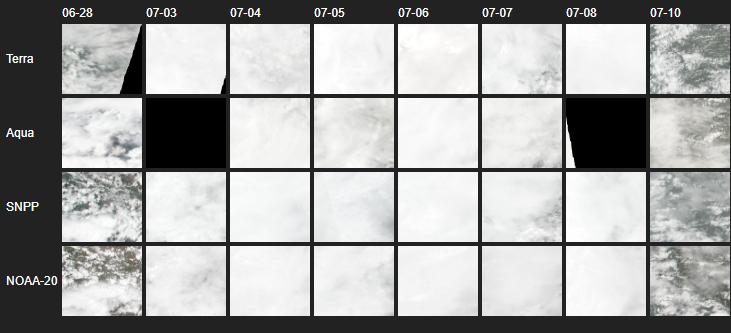

# Cloud check: did ordinary satellite cameras see the ground? (U5)

Evidence for the story line "Ordinary satellite cameras saw only cloud for most of that week".

## Result

On every day from 3 to 8 July 2026, every available NASA daily true-colour image of the study box
was completely white with cloud. On the two radar pass days, 28 June and 10 July, cloud was broken
and parts of the ground were visible.



Rows are sensors, columns are dates (month-day). Black means the sensor did not image the box that day.

| Date | Terra MODIS | Aqua MODIS | Suomi NPP VIIRS | NOAA-20 VIIRS |
|---|---|---|---|---|
| 28 Jun (radar pass) | broken cloud | broken cloud | broken cloud | broken cloud |
| 3 Jul | all cloud | no image | all cloud | all cloud |
| 4 Jul | all cloud | all cloud | all cloud | all cloud |
| 5 Jul | all cloud | all cloud | all cloud | all cloud |
| 6 Jul | all cloud | all cloud | all cloud | all cloud |
| 7 Jul | all cloud | all cloud | all cloud | all cloud |
| 8 Jul | all cloud | no image (96% of the box not covered) | all cloud | all cloud |
| 10 Jul (radar pass) | broken cloud | broken cloud | broken cloud | broken cloud |

So for 3 to 8 July: 22 images available out of 24, and all 22 show only cloud.

## What this does and does not show

- It covers four NASA daily imagers, each passing once in daylight. It does not cover every
  optical satellite (Sentinel-2 and Landsat were not checked), so say "NASA's daily satellite
  images" if a judge asks which cameras.
- "All cloud" was judged by eye and backed by a rough count: in those 22 images, 0% of pixels were
  anything other than white (a pixel counts as "not white" when any colour channel is below 140 of 255).
  On 28 June and 10 July the same count gave 3% to 29%, depending on the sensor. This is a rough
  aid, not a cloud-cover measurement.
- On 10 July, the day NISAR came back, optical sensors did see part of the ground. The story's
  claim is about the storm week, 3 to 8 July, and it holds for all six days, not only "most".

## How to repeat it

Images come from NASA Worldview Snapshots (GIBS), opened on 14 Nov 2026. One image per sensor and
date, cut to the study box (south 18.15, west 73.3, north 18.9, east 74.1):

```
https://wvs.earthdata.nasa.gov/api/v1/snapshot?REQUEST=GetSnapshot&TIME=<DATE>T00:00:00Z&BBOX=18.15,73.3,18.9,74.1&CRS=EPSG:4326&LAYERS=<LAYER>&WRAP=day&FORMAT=image/jpeg&WIDTH=320&HEIGHT=300
```

`<DATE>`: 2026-06-28, 2026-07-03 to 2026-07-08, 2026-07-10.

`<LAYER>`:

- `MODIS_Terra_CorrectedReflectance_TrueColor`
- `MODIS_Aqua_CorrectedReflectance_TrueColor`
- `VIIRS_SNPP_CorrectedReflectance_TrueColor`
- `VIIRS_NOAA20_CorrectedReflectance_TrueColor`

The same dates can be browsed at https://worldview.earthdata.nasa.gov.

Image credit: NASA GIBS / Worldview Snapshots. Check NASA's acknowledgement wording before the
contact sheet goes on a slide or the project page.
